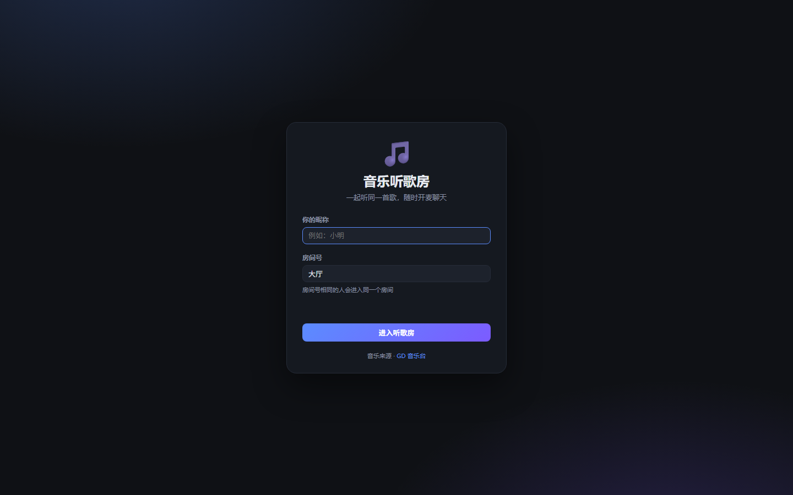
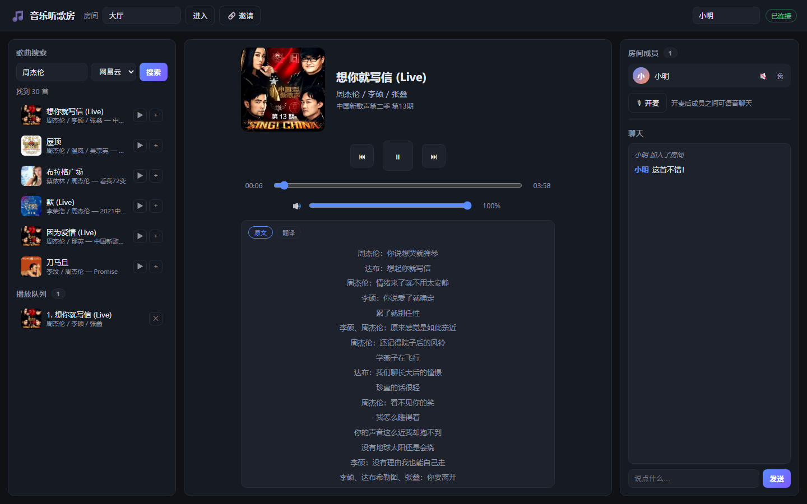

# 音乐听歌房 · Music Room

在线多人音乐听歌房：**音乐由 [GD Studio 音乐台 API](https://music.gdstudio.org/) 提供**，
**用户之间 P2P 连接**（WebRTC 语音），并支持**文字聊天**与**播放进度同步**。

服务端**不代理音乐数据**：只广播曲目 ID 与元数据，每个客户端各自直连上游获取播放地址与音频。





## 功能特性

| 模块 | 说明 |
| --- | --- |
| 🚪 进入房间 | 独立的入口页，先填写昵称与房间号再进入听歌界面；显示当前有人的房间便于快速加入 |
| 🎵 音乐来源 | 浏览器直连 [GD 音乐台 API](https://music.gdstudio.xyz/api.php)，支持 `netease` / `joox` / `bilibili` 等音源，并自动探测音源可用性 |
| 🔍 搜索 | 歌名 / 歌手 / 专辑关键字搜索，每页 30 条，支持「加载更多」翻页 |
| 📻 播放同步 | 服务端维护权威播放状态（曲目 / 播放中 / 位置），客户端用时钟偏移估算对齐，误差 > 350ms 自动校正 |
| 🎚️ 独立音质 | 每个客户端可单独选择 128/192/320/无损，互不影响 |
| 🎤 开麦语音 | WebRTC Mesh P2P，成员之间点对点传输语音；使用完美协商（perfect negotiation）避免信令冲突 |
| 💬 文字聊天 | 房间内实时聊天；迟到加入的成员会收到最近 50 条历史消息 |
| 📃 歌词 | LRC 解析 + 逐行高亮滚动，支持原文 / 翻译切换 |
| 🖼️ 封面 | 直连上游取地址，渐进加载只拉取可视区域内的封面 |
| 👥 成员列表 | 头像、昵称、开麦状态指示 |
| 🔗 房间邀请 | 房间名 + 分享链接（`?room=<房间名>`） |

## 技术栈

- **服务端**：Node.js 18+，**零运行时依赖**（原生 `http` + 自研 WebSocket 实现）
  —— 只做房间与广播，不代理音乐
- **前端**：原生 ES Module，无构建步骤、无框架
- **音乐来源**：浏览器**直连** GD 音乐台 API（上游已开启 CORS）
- **实时通信**：WebSocket（信令 / 聊天 / 状态同步）
- **语音**：WebRTC（`RTCPeerConnection` + STUN）

## 架构：服务端不代理音乐

```
┌─────────────┐   ①搜索（直连上游）    ┌──────────────────┐
│  浏览器 A   │ ─────────────────────→ │  GD 音乐台 API   │
└──────┬──────┘                        └──────────────────┘
       │ ②广播曲目 ID + 元数据
       ▼
┌─────────────┐
│   服务端    │  ← 只保存房间状态，不碰音乐数据，不消耗上游配额
└──────┬──────┘
       │ ③广播曲目 ID + 元数据
       ▼
┌─────────────┐   ④各自分别取地址 + 拉流
│  浏览器 B   │ ─────────────────────→ 上游 CDN（音频直连）
└─────────────┘
```

**服务端只广播曲目 ID 与元数据**（`id` / `name` / `artist` / `album` / `pic_id` / `lyric_id` / `source`），
**不包含播放地址**。每个客户端收到广播后，各自独立：

1. 向 GD 音乐台请求该曲目的**播放地址**
2. 浏览器**直接从上游 CDN 拉流**播放（音频流量完全不经过我们的服务器）
3. 各自拉取封面与歌词

这样带来的好处：

- **服务端零上游消耗**：不受上游 50 次/5 分钟配额限制，不再需要代理缓存与限流队列
- **带宽成本为零**：音频字节流由客户端与上游 CDN 直连
- **每个客户端可独立选择音质**（128/192/320/无损），互不影响
- **一个客户端失败不影响其他人**：某人网络差取不到地址，其他人照常播放

上游地址：`https://music-api.gdstudio.xyz/api.php`（已开启 `Access-Control-Allow-Origin: *`），
由服务端通过 `/api/health` 与 `/api/config` 告知客户端。

## 快速开始

> **本项目零运行时依赖** —— 只需装好 Node.js，不用 pnpm / npm，也不用联网装包。

### Windows

双击 **`start.bat`** 即可（或在命令行里运行 `start.bat`）。

### Linux / macOS

```bash
chmod +x start.sh   # 首次执行需要给权限
./start.sh
```

脚本会自动检查 Node.js 是否安装、版本是否够（需要 18+），然后启动服务。

### 手动启动（可选）

```bash
node server/index.js
```

启动后打开浏览器访问 **http://localhost:3000** 即可。

### 换端口

改脚本顶部的 `PORT=3000` 即可，或用环境变量：

```bash
# Windows
set PORT=8080 && node server\index.js

# Linux / macOS
PORT=8080 node server/index.js
```

### 局域网 / 公网访问

监听地址默认为 `0.0.0.0`，同一局域网内的其他设备可直接访问
（脚本启动后会打印局域网地址，例如 `http://192.168.1.63:3000`）：

```bash
PORT=3000 HOST=0.0.0.0 node server/index.js
# 朋友访问 http://<你的局域网IP>:3000/?room=房间名
```

> ⚠️ **开麦必须使用 HTTPS 或 localhost**。
> 浏览器只在安全上下文（`https://` 或 `localhost`）下开放 `getUserMedia`。
> 部署到公网时请在前面加一层 Nginx / Caddy 反向代理并配置 TLS，否则开麦按钮会失败。

### 关于 pnpm / npm

**运行服务完全不需要它们。** `package.json` 里的依赖只是开发期用的测试工具：

| 依赖 | 用途 | 运行时需要？ |
| --- | --- | --- |
| `ws` | 仅测试用（验证自研 WebSocket 实现） | ❌ |
| `puppeteer-core` | 仅 UI 测试用 | ❌ |

只有在跑测试时才需要安装：

```bash
npm install        # 或 pnpm install
npm test           # 跑全部测试
```

## 使用方式

1. 打开页面先在**入口页**填写昵称与房间号，点「进入听歌房」。
   房间号相同的人会进入同一个房间；入口页还会列出当前有人的房间，点击可快速填入。
2. 左栏搜索歌曲，点 `▶` 立即播放并同步给全房间；点 `+` 只加入播放队列。
3. 任意成员切歌 / 暂停 / 拖动进度条，其他成员的播放器会自动对齐。
4. 点右上「🔇 开麦」授权麦克风，即可与其他成员语音聊天；再次点击静音。
5. 点「🔗 邀请」复制房间链接分享给朋友。
6. 顶部房间号可以直接改，点「进入」即切换到新房间（无需刷新）。

## 目录结构

```
music_room/
├── start.bat           # Windows 一键启动（双击即可）
├── start.sh            # Linux / macOS 一键启动
├── server/
│   ├── index.js        # HTTP 服务 + WebSocket 入口（只广播，不代理音乐）
│   ├── rooms.js        # 房间、成员、播放列表、播放状态
│   └── ws.js           # 自研 WebSocket 服务端实现（零依赖）
├── public/
│   ├── index.html
│   ├── styles.css
│   └── js/
│       ├── main.js         # 应用装配 + 入口页流程
│       ├── gd-api.js       # GD 音乐台 API 客户端（浏览器直连 + 缓存 + 重试）
│       ├── ws.js           # WebSocket 客户端（含时钟校准）
│       ├── player.js       # 同步播放器（各自取地址、各自拉流）
│       ├── rtc.js          # WebRTC Mesh 语音
│       ├── chat.js         # 聊天面板
│       ├── search.js       # 搜索面板
│       ├── cover-loader.js # 封面渐进加载器
│       └── lyrics.js       # 歌词解析与滚动
├── test/
│   ├── integration.test.js   # 服务端 + WebSocket 集成测试
│   ├── websocket.test.js     # 自研 WebSocket 实现协议测试
│   ├── lyrics.test.js        # 歌词解析与翻译对齐单元测试
│   ├── ui.test.js            # 浏览器端到端测试（puppeteer-core）
│   ├── sources.test.js       # 各音源可用性检查
│   └── screenshot.mjs        # 生成文档截图
└── docs/
    ├── protocol.md     # 通信协议
    └── contracts.md    # 前端模块契约
```

## 测试

```bash
# 服务端集成测试（12 项）
node --test test/integration.test.js

# WebSocket 协议测试（6 项）
node --test test/websocket.test.js

# 歌词解析单元测试（9 项）
node --test test/lyrics.test.js

# 浏览器端到端测试（31 项，需要本机 Chrome）
node test/ui.test.js

# 各音源可用性检查（netease / joox / bilibili）
node test/sources.test.js
```

UI 测试会真实拉起两个浏览器标签页，验证：入口页流程、搜索与翻页、播放同步、
**播放地址确实直连上游 CDN 且未经过服务端**、聊天与历史记录补发、
封面渐进加载、歌词与翻译切换、拖动进度条、开麦状态广播、
以及 **WebRTC 双向音轨是否真正建立**。

Chrome 路径可通过环境变量覆盖：

```bash
CHROME_PATH="C:\Program Files\Google\Chrome\Application\chrome.exe" node test/ui.test.js
```

> ⚠️ **测试之间建议间隔 30 秒以上**。
> 上游配额按来源 IP 计算（50 次 / 5 分钟），连续跑多个测试套件会耗尽配额，
> 导致偶发失败（表现为"Failed to fetch"或"没有找到相关歌曲"）。
> 这是上游限制，与代码无关 —— 稍等片刻重跑即可。

## API 说明

### 服务端接口

服务端只提供房间相关接口，**不再代理任何音乐数据**：

| 路径 | 用途 |
| --- | --- |
| `GET /api/rooms` | 房间列表 |
| `GET /api/health` | 健康检查（含上游地址） |
| `GET /api/config` | 返回上游地址 |

### 客户端直连上游

浏览器直接调用 GD 音乐台 API（`https://music-api.gdstudio.xyz/api.php`），
封装在 `public/js/gd-api.js`：

| 调用 | 上游参数 | 说明 |
| --- | --- | --- |
| `searchTracks({source, name, count, pages})` | `types=search` | 搜索歌曲 |
| `getTrackUrl({source, id, br})` | `types=url` | 获取播放地址 |
| `getTrackPic({source, id, size})` | `types=pic` | 获取封面地址 |
| `getTrackLyric({source, id})` | `types=lyric` | 获取歌词 |

客户端侧的自我保护（`public/js/gd-api.js`）：

- **TTL 缓存**：搜索 60s、播放地址 4min、封面 24h、歌词 10min
- **请求合并**：相同 URL 的并发请求只发一次上游
- **指数退避重试**：503 时自动退避重试 2 次
- **渐进加载封面**：只为可视区域内的条目请求封面，并发限制 3

> 上游仍有 **50 次 / 5 分钟** 的配额限制，但现在是**每个客户端各算各的**，
> 服务端不再消耗任何配额。单个浏览器频繁搜索仍可能触发上游 503，
> 此时界面会提示"搜索失败"，稍后重试即可。

## 已知限制

### 上游音源现状（实测）

| 音源 | 搜索 | 播放地址 | 封面 | 歌词 | 说明 |
| --- | --- | --- | --- | --- | --- |
| `netease` 网易云 | ✅ | ✅ | ✅ | ✅ | **完全可用** |
| `joox` | ✅ | ❌ | ✅ | ✅ | 上游 `types=url` 恒返回空地址（抽样 0/30） |
| `bilibili` | ⚠ | ⚠ | ✅ | ⚠ | 搜索结果不稳定（同一关键字有时返回 0 条） |

> 这是**上游音源自身**的限制，与是否代理无关 —— 直连与代理拿到的是同一个上游响应。
> 应用会在搜索后主动探测音源可用性，搜得到但播不了时给出明确提示
> （"该音源（joox）暂不可用，请换用网易云音源"），而不是静默失败。

### 其他限制

- **Mesh 拓扑**：语音为全连接，每个成员都会与房间内其他人建立 P2P 连接。
  适合 3～8 人的小房间；人数更多建议引入 SFU（如 mediasoup / LiveKit）。
- **NAT 对称型**：仅配置了 STUN，未配置 TURN。
  对称型 NAT 环境下部分成员可能无法建立 P2P 连接，
  生产部署建议在 `public/js/rtc.js` 的 `ICE_SERVERS` 中加入 TURN 服务器。
- **播放地址有效期**：上游返回的音频链接约 20 分钟过期，
  失效时客户端会自动重新请求地址。
- **依赖上游 CORS**：直连方案要求上游持续开启 `Access-Control-Allow-Origin`。
  若上游将来关闭 CORS，需要改回服务端代理。
- **各客户端音质独立**：不同成员可能听到不同音质，这是预期行为。
- **上游配额按 IP 计**：上游限流 50 次/5 分钟按来源 IP 计算。
  直连后每个浏览器各自消耗配额，**同一局域网共用一个出口 IP 时会互相挤占**。
  服务端代理时代这个问题只算在服务器头上，现在分摊到了每个客户端。
- **上游可用性**：GD 音乐台 API 属于第三方服务，可能限流或临时不可用。
  由于每个客户端独立请求，某个客户端失败不会影响房间内其他人。

## 致谢与声明

音乐内容来自 **GD 音乐台（[music.gdstudio.org](https://music.gdstudio.org/)）**，
接口文档见 [music-api.gdstudio.xyz](https://music.gdstudio.xyz/api.php)。
该 API 采用 CC BY-NC 4.0 协议，**仅限学习参考，禁止商用**。

## License

MIT
